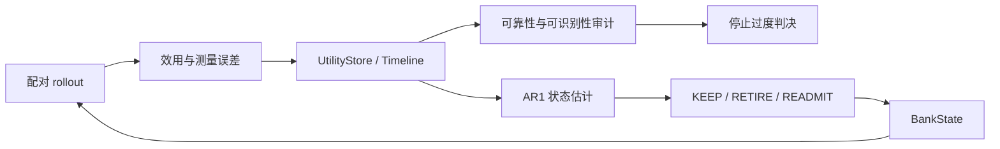

# AgentSkillOps

> Policy-aware skill lifecycle for LLM agents：让技能库的保留、复测、停用和恢复都有证据可查。

Agent 可以持续写入经验，删除长期记忆却是另一回事。一条技能在当前 checkpoint 表现不好，
可能是真的失效，也可能只是 140 个评测任务里的抽样噪声。AgentSkillOps 处理后一个问题：
如何在策略持续变化时，用可复核的证据维护技能库。

我最初想验证「短期有害的技能会不会随训练恢复」。5 个 checkpoint 跑完后，恢复速度仍不可
识别。这迫使我把问题往前推了一步：先确认测量是否可信、归因单位是否正确，再讨论退休算法。
最终产出是一套可以独立运行的离线治理层，而不是一个依赖特定训练框架的实验脚本集合。

## 我负责的部分

- 从 full / leave-one-out 同行 rollout 定义配对效用，补齐标准误、多重比较和样本量估计。
- 设计 `UtilityStore -> UtilityTimeline -> DecisionRule -> BankState` 数据链路，把统计结果变成
  `KEEP / RETIRE / READMIT` 状态动作。
- 实现 AR(1) 状态估计和 VOI 复测排序；错误退休与漏退使用显式成本比，不藏在经验阈值里。
- 建立 2×2 因子分解、预注册非劣检验和 OOD 验证流程，并保留未通过验证的规则。
- 将研究代码整理为可安装 Python 包、确定性 CPU 自检和机器可读结果，核心层只依赖标准库。

技术栈：Python、状态空间模型、配对实验设计、bootstrap / McNemar 检验、离线 Agent 评测。

## 结果先放在前面

| 问题 | 观测 | 可支持的结论 |
|---|---:|---|
| 单个 general skill 能否据一次 LOO 判决 | 26 个 `(skill, checkpoint)` 单元在多重校正后 0 个显著 | 当前 140-task 预算不足以支撑单技能淘汰 |
| 1.5B Agent 的完整技能库是否有价值 | ckpt20 `+0.114`；ckpt40 `+0.136` | 技能库整体有价值，但不能据此推出每个技能都有价值 |
| 价值主要来自哪一层 | TS 主效应 `+0.114`，95% CI `[+0.057,+0.171]`；General 主效应 CI 跨 0 | 该 checkpoint 上价值主要由 task-specific 组承载 |
| 只保留部分任务组能否泛化 | OOD 相对 full 为 `-0.052`，未通过 5 pp 非劣界 | 探索集上的组选择规则不能直接部署 |
| 整体移除 general 是否可作低成本基线 | OOD `+0.037`，prompt token `-12.5%`；另一数据集非劣检验未通过 | 是当前较强基线，但泛化边界尚未完全确证 |
| “伤害会随时间恢复”是否成立 | 5 点轨迹下 `phi` 的 95% profile CI 仍为 `[0,1]` | 不支持该动态假设，不能宣称已学到全局最优退休策略 |

更完整的证据、限制和判读规则见[实验报告](docs/实验报告.md)。

## 从评测到技能状态



核心职责和数据流见[架构设计](docs/架构设计.md)。

这条链路有三个工程约束：没有观测的技能不会被退休；VOI 只分配测量预算，不篡改决策；
已退休技能可以通过探测重新进入技能库。统计模型给不出窄区间时，系统选择不做永久动作。

## 快速开始

```bash
python -m venv .venv
# Windows: .venv\Scripts\activate
# Linux/macOS: source .venv/bin/activate
pip install -e ".[analysis,dev]"

pytest
python experiments/selfcheck_freshness.py
python experiments/selfcheck_lifecycle.py
python experiments/selfcheck_stage57.py
```

无需第三方依赖也可以运行三个 `selfcheck`；`scipy` 只用于精确二项区间等分析。
完整命令与输入输出对应关系见[复现指南](docs/复现指南.md)。

最小决策接口：

```python
from freshskill import UtilityTimeline
from freshskill.retirement import ConfirmRule, series_from_timeline

timeline = UtilityTimeline.load(
    "results/stage55_measure/utility_store_timeline_5pt.json"
)
series = series_from_timeline(timeline, "gen_005")

# 连续两个周期低于阈值才退休；缺少观测时保持活动。
rule = ConfirmRule(theta=-0.02, cycles=2)
action = rule.decide(series, status="active")
print(action)  # KEEP 或 RETIRE
```

## 目录说明

```text
freshskill/   # 效用存储、时间线、状态估计和生命周期决策
experiments/  # CPU 审计、因子分析、非劣检验和确定性自检
results/      # 精选配对表与机器可读结果，不含模型和原始轨迹
tests/        # 核心不变量的标准库单元测试
docs/         # 架构、实验判读和复现说明
```

## 代码中的判断

1. 先检查测量单位。bank 有价值而 general 单技能 LOO 近似为零，问题更像归因层级错位，
   此时继续堆打分器没有意义。
2. `phi` 不可识别时就返回宽区间，不拿点估计包装「动态恢复」。
3. 小样本分组未检出收益，不等于可以永久禁用。selective 规则在 OOD 上失败，所以它只作为
   反例保留，不进入部署建议。
4. 仓库只公开复核结论所需的数据。模型、环境副本和原始轨迹留在本地，Git 历史保持可克隆。

这也是我希望通过仓库展示的 Agent 工程能力：不只把模型接进流程，还要知道评测信号何时足以
触发自动动作，何时应该降级为人工审查或继续收集证据。

## 项目边界与上游归属

本项目是在 [AIMING Lab / SkillRL](https://github.com/aiming-lab/SkillRL) 实验体系上的个人研究扩展。
SkillRL 提供技能抽取、技能库和 Agent 训练基础；本仓库聚焦于技能效用时间线、可靠性审计、
生命周期决策与独立验证。上游训练框架代码、模型权重和数据集均未作为个人成果收录。

详细归属见 [NOTICE.md](NOTICE.md)。仓库代码采用 MIT License；上游组件仍遵循其各自许可。
