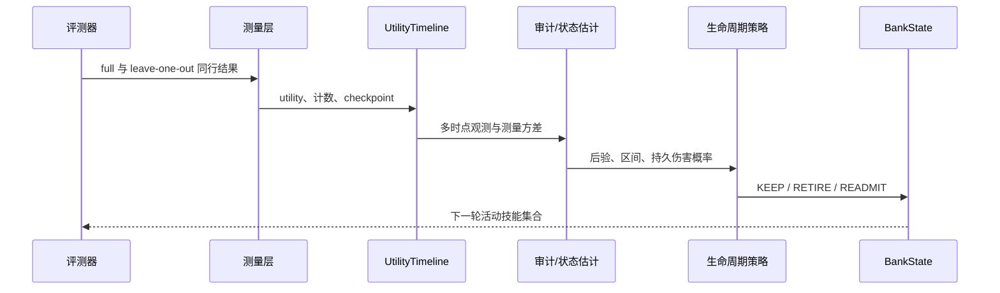

# AgentSkillOps 架构设计

## 目标

AgentSkillOps 不负责训练 Agent，而是回答技能库维护中的三个问题：

1. 当前证据能否区分技能真实效用与 rollout 噪声？
2. 当策略迭代后，旧测量还能以多大权重参与决策？
3. 在错误退休和漏掉有害技能的成本不对称时，应当复测谁、停用谁、恢复谁？

系统刻意保持为一个独立的离线决策层。它读取配对评测结果并输出技能状态，不侵入训练框架，
便于替换 Agent、环境或策略模型。

## 接入边界

上游评测器只需要提供任务标识、是否成功、token/step 成本和本轮启用的技能集合。治理层不读取
模型内部状态，也不要求特定推理服务。输出是技能 ID 到状态动作的映射，调用方可以先进入人工
审批，也可以在达到既定置信门槛后写回技能库。

这层边界是有意设计的。训练框架负责产生策略，Agent runtime 负责检索与执行，AgentSkillOps
只负责离线证据聚合和状态建议。三者可以独立替换。

## 数据流



## 模块职责

| 模块 | 职责 | 关键约束 |
|---|---|---|
| `utility_store.py` | 按策略版本保存技能效用和 help/harm/neutral 计数 | 不在存储层解释因果 |
| `timeline.py` | 将多个策略版本折叠为 checkpoint 时间线 | 同一技能的时间轴显式可查 |
| `measurement.py` | 配对效用、标准误、区间、多重比较和功效估计 | 使用配对结果方差，不套用独立比例公式 |
| `state_space.py` | AR(1) 滤波、平滑、profile likelihood 和预测 | 参数不可识别时返回宽区间 |
| `retirement.py` | 阈值基线、后验决策、READMIT 和 VOI | 决策阈值来自显式成本比 |
| `lifecycle.py` | 简单的连续两次确认与复测优先级 | 未测量技能默认保留 |
| `bank_state.py` | 持久化活动/退休状态 | 状态变更与统计估计解耦 |

所有规则共享 `decide(series, status)` 接口。基线规则和后验规则因此可以在同一份时间线上比较，
也能在不改评测器的前提下替换。

## 关键不变量

- **同行配对**：效用定义为同一任务上“有该技能”与“移除该技能”的结果差，避免任务难度
  差异污染估计。
- **无数据不退休**：缺少测量不是负效用，空序列必须保持活动状态。
- **决策与采样分离**：VOI 只决定下一次测谁，不覆盖生命周期规则。
- **退休可逆**：已退休技能通过探测获得新证据后可以 `READMIT`，但恢复阈值包含探测成本，
  避免状态频繁翻转。
- **不可识别即降级**：若 `phi` 的 profile 区间无法区分暂态与持久态，只报告条件分析，
  不把点估计当作事实。

## 成本化决策

令 `p` 为技能持续有害的后验概率，`c_FR` 为错误退休成本，`c_MH` 为保留有害技能成本：

```text
退休条件：c_FR × (1 - p) < c_MH × p
等价阈值：p > c_FR / (c_FR + c_MH)
```

代码用 `alpha = c_MH / (c_FR + c_MH)` 表示同一成本比。`alpha=0.05` 等价于认为错误退休
的成本是漏退的 19 倍。这使规则的业务偏好可见，也防止把人为代价比误写成数据结论。

## 为什么没有继续增加抽象

当前输入是小规模、离线、按 checkpoint 产生的评测表。标准库数据结构和 JSON 已足够完成
计算与审计，因此没有引入数据库、在线服务或工作流框架。未来只有在测量频率、并发写入或
跨实验查询成为真实瓶颈时，才值得替换存储层。
